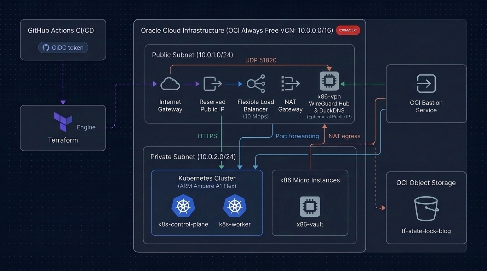
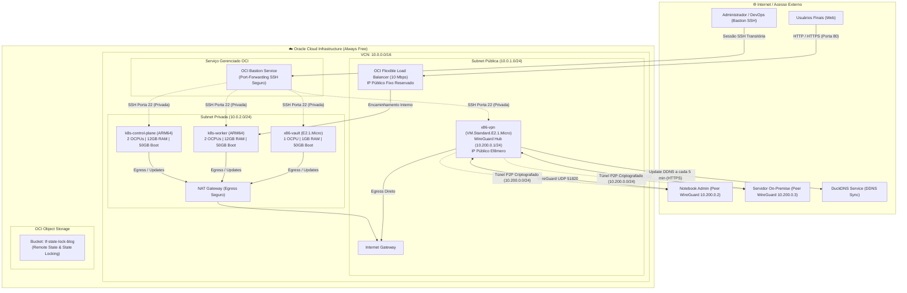
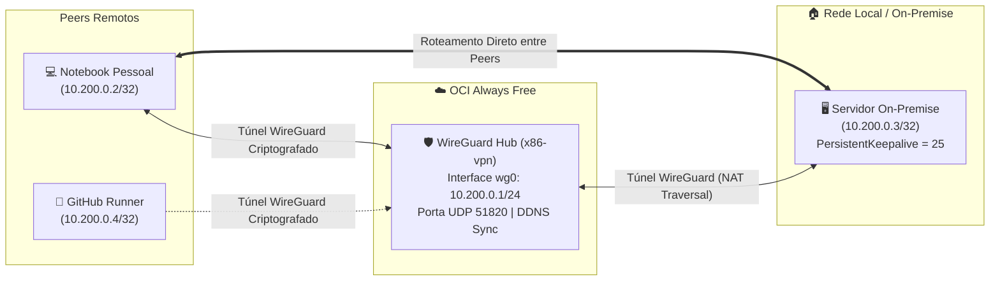
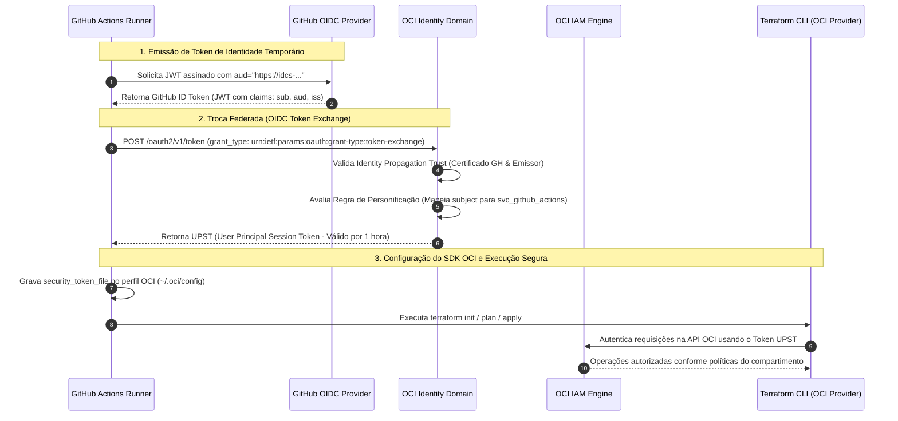

# ☁️ OCI Always Free Infrastructure as Code (IaC) & GitOps

[](https://www.terraform.io/)
[](https://www.oracle.com/cloud/)
[](https://github.com/features/actions)
[](https://kubernetes.io/)
[](#-hub-vpn-wireguard--duckdns-dinâmico)
[](#-autenticação-federada-oidc-token-exchange)

Projeto modular de **Infrastructure as Code (IaC)** e esteira **GitOps/CI-CD** para provisionamento automatizado de uma arquitetura completa na **Oracle Cloud Infrastructure (OCI)**, 100% elegível ao tier **Always Free**.

O projeto adota os mais elevados padrões da indústria em **segurança em nuvem**: autenticação sem chaves estáticas (*keyless*) via **OIDC Token Exchange**, segregação em subnets privadas, acesso administrativo exclusivo via **OCI Bastion Service**, e controle de estado nativo com **state locking** em OCI Object Storage.

---

## 🏗️ Arquitetura da Solução

<p align="center">
  
</p>

<details>
<summary><b>🔍 Expandir Topologia Lógica de Rede</b></summary>



</details>

### Destaques dos Recursos
- **Cluster Kubernetes (ARM Ampere A1 Flex)**:
  - 2 instâncias `VM.Standard.A1.Flex` somando **4 OCPUs e 24 GB de RAM** (limite exato gratuito da OCI).
  - Provisionamento automatizado via Cloud-Init/Userdata com `containerd`, `kubeadm`, `kubelet`, `kubectl` e CNI Flannel.
- **Instâncias x86 Micro**:
  - 2 instâncias `VM.Standard.E2.1.Micro` (1 OCPU, 1 GB de RAM cada) para serviços utilitários:
    - **`x86-vault`**: HashiCorp Vault alocado na **Subnet Privada**, isolado da internet.
    - **`x86-vpn`**: Hub WireGuard alocado na **Subnet Pública** com IP Público Efêmero e sincronização dinâmica via DuckDNS.
- **Armazenamento em Disco**:
  - 4 instâncias de 50 GB = **200 GB de Boot Volumes** (cota máxima do Always Free).
- **Rede e Isolamento de Borda**:
  - Segregação estrita entre **Subnet Pública (10.0.1.0/24)** e **Subnet Privada (10.0.2.0/24)**.
  - As instâncias privadas (`k8s-control-plane`, `k8s-worker`, `x86-vault`) não possuem IP público (`assign_public_ip = false`) e utilizam NAT Gateway para saída segura.
  - A instância `x86-vpn` possui IP público efêmero para receber conexões WireGuard (UDP `51820`), mantendo sua porta SSH (TCP `22`) estritamente restrita à rede privada e ao Bastion.
  - Network Security Groups (NSGs) com regras granulares para as portas do Kubernetes (`6443`, `10250`, `8472 UDP`) e da VPN.
- **Load Balancer e IP Fixo**:
  - 1 Load Balancer Flexível de 10 Mbps distribuindo tráfego web.
  - 1 IP Público Reservado permanente associado ao Load Balancer.
- **Acesso Administrativo Zero-Trust**:
  - Acesso SSH a **todas** as máquinas (incluindo as privadas e a VPN) realizado exclusivamente via **OCI Bastion Service** sob demanda, eliminando qualquer exposição de portas de gerenciamento na internet.

---

## 🔒 Hub VPN WireGuard & DuckDNS Dinâmico

A solução inclui uma instância dedicada (`x86-vpn`) que atua como **Hub WireGuard** seguro e de alto desempenho, estabelecendo uma topologia *hub-and-spoke* para interconectar dispositivos remotos (como o notebook pessoal e runners de CI/CD) ao **servidor on-premise residencial**, sem necessidade de abrir portas SSH ou expor o laboratório doméstico à internet.



### Principais Características da VPN:
1. **Roteamento Exclusivo P2P (Zero-Trust OCI)**:
   - A interface `wg0` opera na faixa isolada `10.200.0.0/24`.
   - O encaminhamento de pacotes no kernel (`net.ipv4.ip_forward = 1`) é restrito estritamente entre peers da VPN (`iptables -A FORWARD -i wg0 -o wg0 -j ACCEPT`).
   - Dispositivos conectados à VPN têm acesso exclusivamente ao servidor on-premise (`10.200.0.3/32`), sem qualquer rota ou permissão para alcançar a VCN interna da OCI (`10.0.0.0/16`).
2. **Sincronização Dinâmica com DuckDNS**:
   - Para acomodar o IP público efêmero Always Free da OCI, um cron job roda a cada 5 minutos (`/etc/cron.d/duckdns`) executando `/opt/duckdns/duck.sh`.
   - Mantém o subdomínio DuckDNS (ex: `guilermiii-vpn.duckdns.org`) sempre atualizado com o IP público atual da instância, garantindo reconexão automática e ininterrupta dos peers.
3. **Gestão Segura de Acesso Administrativo (SSH)**:
   - O Network Security Group (`vpn_nsg`) libera apenas a porta **UDP `51820`** para `0.0.0.0/0`.
   - A porta SSH (TCP `22`) **não é exposta publicamente**, sendo autorizada exclusivamente a partir da Subnet Privada (`10.0.2.0/24`), viabilizando acesso exclusivo via **OCI Bastion**.
4. **Perfis de Clientes Automatizados**:
   - O script userdata gera automaticamente os pares de chaves criptográficas (`wg genkey`) e os perfis prontos para uso em `/home/ubuntu/wireguard-clients/`:
     * `notebook.conf` (e `notebook.qr.txt` para importação instantânea em dispositivos móveis/desktop).
     * `onpremise.conf` (com `PersistentKeepalive = 25` para manter o NAT residencial aberto).
     * `github-runner.conf` (para execuções automatizadas futuras).

---

## 🔐 Autenticação Federada: OIDC Token Exchange (Keyless CI/CD)

Tradicionalmente, pipelines CI/CD utilizam chaves de API privadas de longa duração (`.pem`) armazenadas nos segredos do GitHub, o que introduz riscos de vazamento, necessidade de rotação manual e conformidade deficiente.

Este projeto adota a arquitetura de autenticação recomendada pela **Oracle A-Team**, utilizando **OpenID Connect (OIDC) Token Exchange**:



### Vantagens do Modelo Implementado:
1. **Zero Chaves Privadas no Repositório**: Nenhuma chave `.pem` ou credencial de longa duração é mantida nos secrets do GitHub Actions.
2. **Tokens de Curta Duração**: O UPST (*User Principal Session Token*) gerado expira em 60 minutos.
3. **Impersonação Granular**: O token OIDC do repositório personifica um usuário de serviço dedicado (`svc_github_actions`), membro de um grupo (`GithubActionsGroup`) com políticas estritas de menor privilégio (*Least Privilege*).
4. **Resolução de Subject Claim com IDs Imutáveis**: Compatível com o formato dinâmico de `sub` emitido pelo GitHub Actions (`repo:<org>@<id>/<repo>@<id>:ref:refs/heads/<branch>`), garantindo confiabilidade mesmo com renomeações de repositório.

---

## 🚀 Pipeline de CI/CD (GitHub Actions)

A pipeline é acionada automaticamente a cada `push` na branch `main`:

```yaml
name: "Terraform Deploy OCI (OIDC Token Exchange)"

on:
  push:
    branches:
      - main
  workflow_dispatch:

permissions:
  id-token: write  # Obrigatório para solicitar o JWT OIDC do GitHub
  contents: read

jobs:
  terraform:
    name: "Terraform Plan & Apply"
    runs-on: ubuntu-latest

    env:
      TF_VAR_tenancy_ocid: ${{ secrets.TF_VAR_TENANCY_OCID || secrets.OCI_TENANCY_OCID }}
      TF_VAR_compartment_ocid: ${{ secrets.TF_VAR_COMPARTMENT_OCID || secrets.OCI_COMPARTMENT_OCID || 'ocid1.compartment.oc1..aaaaaaaa...' }}
      TF_VAR_region: ${{ secrets.TF_VAR_REGION || secrets.OCI_REGION || 'sa-saopaulo-1' }}
      TF_VAR_ssh_public_key_value: ${{ secrets.TF_VAR_SSH_PUBLIC_KEY_VALUE || secrets.PUBLIC_KEY_VALUE }}
      TF_VAR_enable_x86_instances: "true"
      TF_VAR_auth: "SecurityToken"
      TF_VAR_oci_config_profile: "DEFAULT"
      TF_VAR_duckdns_token: ${{ secrets.TF_VAR_DUCKDNS_TOKEN || secrets.DUCKDNS_TOKEN }}
      TF_VAR_duckdns_domain: ${{ secrets.TF_VAR_DUCKDNS_DOMAIN || secrets.DUCKDNS_DOMAIN || 'guilermiii-vpn' }}

    steps:
      - name: Checkout do Repositório
        uses: actions/checkout@v4

      - name: Sanitizar URL do Domínio OCI
        run: |
          RAW_URL="${{ secrets.OCI_DOMAIN_URL }}"
          echo "CLEAN_DOMAIN_URL=${RAW_URL%/}" >> $GITHUB_ENV

      - name: Run OCI Token Exchange Action
        uses: gtrevorrow/oci-token-exchange-action@v2
        with:
          oidc_client_identifier: ${{ secrets.OCI_CLIENT_ID }}:${{ secrets.OCI_CLIENT_SECRET }}
          domain_base_url: ${{ env.CLEAN_DOMAIN_URL }}
          oci_tenancy: ${{ secrets.TF_VAR_TENANCY_OCID || secrets.OCI_TENANCY_OCID }}
          oci_region: ${{ secrets.TF_VAR_REGION || secrets.OCI_REGION || 'sa-saopaulo-1' }}
          oci_profile: 'DEFAULT'

      - name: Setup Terraform
        uses: hashicorp/setup-terraform@v3
        with:
          terraform_wrapper: false

      - name: Terraform Init
        run: terraform init -input=false -backend-config="auth=SecurityToken" -backend-config="config_file_profile=DEFAULT"

      - name: Terraform Plan
        run: terraform plan -input=false

      - name: Terraform Apply
        run: terraform apply -auto-approve -input=false
```

### Secrets Configuradas na Pipeline (GitHub Actions):

A esteira oferece suporte flexível aos nomes de segredos tanto no padrão do Terraform em maiúsculas (`TF_VAR_*`) quanto no padrão clássico:

| Secret | Descrição | Obrigatório / Opcional |
| :--- | :--- | :--- |
| `OCI_DOMAIN_URL` | URL base do Identity Domain OCI (ex: `https://idcs-xxx.identity.oraclecloud.com`) | **Obrigatório** |
| `OCI_CLIENT_ID` | Client ID da aplicação confidencial cadastrada no Identity Domain | **Obrigatório** |
| `OCI_CLIENT_SECRET` | Client Secret correspondente da aplicação confidencial | **Obrigatório** |
| `TF_VAR_COMPARTMENT_OCID` | OCID do Compartment Always Free (suporta `OCI_COMPARTMENT_OCID` e fallback seguro) | **Recomendado** |
| `TF_VAR_TENANCY_OCID` | OCID da Tenancy Oracle Cloud (suporta `OCI_TENANCY_OCID`) | **Obrigatório** |
| `TF_VAR_REGION` | Região da OCI (suporta `OCI_REGION` - default: `sa-saopaulo-1`) | Opcional |
| `TF_VAR_SSH_PUBLIC_KEY_VALUE` | Chave pública SSH injetada nas instâncias (suporta `PUBLIC_KEY_VALUE`) | **Obrigatório** |
| `TF_VAR_DUCKDNS_TOKEN` | Token secreto de autenticação da API DuckDNS para sincronização da VPN | **Obrigatório p/ VPN** |
| `TF_VAR_DUCKDNS_DOMAIN` | Subdomínio DuckDNS (suporta `DUCKDNS_DOMAIN` - default: `guilermiii-vpn`) | Opcional |

---

## 🛡️ Práticas de Engenharia e Proteção de Ciclo de Vida

Para garantir resiliência e estabilidade contra *state drift* e recriações destrutivas acidentais, o projeto implementa proteções de ciclo de vida no Terraform:

- **Proteção contra recriação de nós (`lifecycle.ignore_changes`)**:
  - Instâncias ARM ([`module.k8s-arm/compute.tf`](file:///home/guilermiii/github/oci-blog/module.k8s-arm/compute.tf)) e x86 ([`module.x86-instances/compute.tf`](file:///home/guilermiii/github/oci-blog/module.x86-instances/compute.tf)) possuem `ignore_changes = [metadata]`. Mudanças de quebras de linha ou espaços na chave SSH não causam destruição de instâncias de computação ativas.
- **Proteção do IP Reservado do Load Balancer**:
  - O recurso de IP público em ([`module.k8s-arm/load_balancer.tf`](file:///home/guilermiii/github/oci-blog/module.k8s-arm/load_balancer.tf)) ignora alterações em `private_ip_id`, respeitando a gestão de interfaces de rede interna da control plane da OCI.
- **Descoberta Dinâmica de Recursos (`datasources.tf`)**:
  - Busca automatizada da imagem mais recente do Ubuntu 24.04 LTS (ARM e x86) e do primeiro Availability Domain da região, eliminando IDs estáticos desatualizados.
- **Backend Remoto Nativo OCI**:
  - Armazenamento centralizado do estado no Object Storage (`backend "oci"`), garantindo bloqueio atômico de execução e evitando condições de corrida.

---

## 📁 Estrutura do Repositório

```text
iac-oci/
├── .github/
│   └── workflows/
│       └── main.yaml               # Pipeline CI/CD GitHub Actions com OIDC Token Exchange
├── module.k8s-arm/                 # Módulo do Cluster Kubernetes ARM64
│   ├── cli/
│   │   ├── controlplane.sh         # Bootstrap do nó Master (containerd, kubeadm, Flannel)
│   │   └── worker.sh               # Bootstrap do nó Worker (containerd, kubeadm, kubelet)
│   ├── compute.tf                  # 2x instâncias Ampere A1 (protegidas com lifecycle)
│   ├── load_balancer.tf            # Load Balancer 10 Mbps + IP Público Fixo Reservado
│   ├── main.tf                     # Entrypoint do módulo K8s
│   ├── outputs.tf                  # Saídas de IPs privados e endpoint do LB
│   ├── security.tf                 # NSGs e regras de firewall para portas do Kubernetes
│   └── variables.tf                # Variáveis de entrada do módulo K8s
├── module.x86-instances/           # Módulo das Instâncias Micro x86
│   ├── cli/
│   │   ├── vault.sh                # Userdata template para HashiCorp Vault
│   │   └── vpn.sh                  # Automação WireGuard Hub, geração de clientes e DuckDNS via cron
│   ├── compute.tf                  # 2x instâncias E2.1.Micro (Vault em privada, VPN em pública)
│   ├── main.tf                     # Entrypoint do módulo x86
│   ├── outputs.tf                  # Saídas de IPs privados e IP público efêmero da VPN
│   ├── security.tf                 # NSGs dedicados para Vault (privado) e VPN (UDP WireGuard)
│   └── variables.tf                # Variáveis de entrada do módulo x86
├── scripts/
│   └── ssh-connect.sh              # Conexão SSH segura via OCI Bastion sob demanda
├── backend.tf                      # Backend nativo OCI Object Storage com state locking
├── bastion.tf                      # OCI Bastion Service gerenciado (Always Free)
├── datasources.tf                  # Descoberta dinâmica de ADs e Imagens Ubuntu 24.04
├── main.tf                         # Orquestrador raiz invocando módulos de infraestrutura
├── network.tf                      # VCN, Subnets (Pública/Privada), Route Tables e Gateways
├── outputs.tf                      # Outputs consolidados (IPs, Bastion ID, K8s joins)
├── provider.tf                     # Configuração do provedor OCI
├── terraform.tfvars.example        # Exemplo documentado de variáveis locais (sem segredos)
├── variables.tf                    # Declaração das variáveis do projeto
└── README.md                       # Documentação técnica do projeto
```

---

## 💻 Conexão Administrativa via OCI Bastion

Por questões de segurança e adoção de práticas **Zero-Trust**, o acesso administrativo SSH a **todas as instâncias do projeto** — incluindo as instâncias 100% privadas (`controlplane`, `worker`, `vault`) e a instância pública de VPN (`vpn`) — é intermediado exclusivamente pelo **OCI Bastion Service** sob demanda. Nenhuma porta SSH (TCP 22) é exposta para a internet:

```bash
# Conectar ao nó Control Plane:
./scripts/ssh-connect.sh controlplane

# Conectar ao nó Worker:
./scripts/ssh-connect.sh worker

# Conectar à instância de Vault:
./scripts/ssh-connect.sh vault

# Conectar à instância de VPN:
./scripts/ssh-connect.sh vpn
```

O script utilitário [`scripts/ssh-connect.sh`](file:///home/guilermiii/github/oci-blog/scripts/ssh-connect.sh) cria automaticamente a sessão transitória de *port-forwarding* através da CLI da OCI e estabelece a conexão SSH criptografada diretamente para a máquina privada.

---

## 📄 Licença

Distribuído sob a licença MIT. Consulte `LICENSE` para mais informações.
