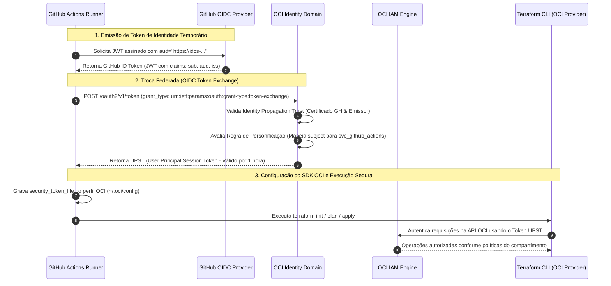

# ☁️ OCI Always Free Infrastructure as Code (IaC) & GitOps

[](https://www.terraform.io/)
[](https://www.oracle.com/cloud/)
[](https://github.com/features/actions)
[](https://kubernetes.io/)
[](#-autenticação-federada-oidc-token-exchange)

Projeto modular de **Infrastructure as Code (IaC)** e esteira **GitOps/CI-CD** para provisionamento automatizado de uma arquitetura completa na **Oracle Cloud Infrastructure (OCI)**, 100% elegível ao tier **Always Free**.

O projeto adota os mais elevados padrões da indústria em **segurança em nuvem**: autenticação sem chaves estáticas (*keyless*) via **OIDC Token Exchange**, segregação em subnets privadas, acesso administrativo exclusivo via **OCI Bastion Service**, e controle de estado nativo com **state locking** em OCI Object Storage.

---

## 🏗️ Arquitetura da Solução

```mermaid
flowchart TB
    subgraph Internet ["🌐 Internet"]
        Users["Usuários Finais"]
        DevOps["Administrador / DevOps"]
    end

    subgraph OCI_Tenancy ["☁️ Oracle Cloud Infrastructure (Always Free Tier)"]
        subgraph VCN ["VCN: 10.0.0.0/16"]
            IGW["Internet Gateway"]
            NAT["NAT Gateway (Egress Seguro)"]

            subgraph Public_Subnet ["Subnet Pública (10.0.1.0/24)"]
                LB["OCI Flexible Load Balancer (10 Mbps)\nIP Público Fixo Reservado"]
            end

            subgraph Bastion_Subnet ["Serviço Gerenciado"]
                Bastion["OCI Bastion Service (Port-Forwarding SSH)"]
            end

            subgraph Private_Subnet ["Subnet Privada (10.0.2.0/24) - Sem IPs Públicos"]
                direction TB
                subgraph K8s_Cluster ["Cluster Kubernetes (ARM Ampere A1)"]
                    CP["k8s-control-plane\n(2 OCPUs, 12GB RAM, 50GB Boot)"]
                    Worker["k8s-worker\n(2 OCPUs, 12GB RAM, 50GB Boot)"]
                end

                subgraph Micro_Instances ["Instâncias x86 Micro"]
                    Vault["x86-vault\n(1 OCPU, 1GB RAM, 50GB Boot)"]
                    VPN["x86-vpn\n(1 OCPU, 1GB RAM, 50GB Boot)"]
                end
            end
        end

        subgraph Object_Storage ["Bucket Remoto OCI"]
            TFLock["tf-state-lock-blog\n(Terraform Remote State & Lock)"]
        end
    end

    Users -->|HTTPS/HTTP| LB
    LB -->|Roteamento Interno| Worker
    DevOps -->|Túnel SSH Seguro| Bastion
    Bastion -.->|SSH 22 (Privado)| CP
    Bastion -.->|SSH 22 (Privado)| Worker
    Bastion -.->|SSH 22 (Privado)| Vault
    Bastion -.->|SSH 22 (Privado)| VPN
    Private_Subnet -->|Saída Egress / Updates| NAT
    NAT --> IGW
```

### Destaques dos Recursos
- **Cluster Kubernetes (ARM Ampere A1 Flex)**:
  - 2 instâncias `VM.Standard.A1.Flex` somando **4 OCPUs e 24 GB de RAM** (limite exato gratuito da OCI).
  - Provisionamento automatizado via Cloud-Init/Userdata com `containerd`, `kubeadm`, `kubelet`, `kubectl` e CNI Flannel.
- **Instâncias x86 Micro**:
  - 2 instâncias `VM.Standard.E2.1.Micro` (1 OCPU, 1 GB de RAM cada) para serviços utilitários (ex: HashiCorp Vault e VPN).
- **Armazenamento em Disco**:
  - 4 instâncias de 50 GB = **200 GB de Boot Volumes** (cota máxima do Always Free).
- **Rede e Isolamento de Borda**:
  - Subnet Privada sem atribuição de IPs públicos para instâncias (`assign_public_ip = false`).
  - NAT Gateway fornecendo saída transparente para a internet para atualizações de pacotes e downloads de imagens.
  - Network Security Groups (NSGs) com regras granulares para as portas do Kubernetes (`6443`, `10250`, `8472 UDP`).
- **Load Balancer e IP Fixo**:
  - 1 Load Balancer Flexível de 10 Mbps distribuindo tráfego web.
  - 1 IP Público Reservado permanente associado ao Load Balancer.
- **Acesso Administrativo Zero-Trust**:
  - Acesso SSH às máquinas privadas exclusivamente via **OCI Bastion Service** sob demanda, eliminando a necessidade de Jump Hosts abertos para a internet.

---

## 🔐 Autenticação Federada: OIDC Token Exchange (Keyless CI/CD)

Tradicionalmente, pipelines CI/CD utilizam chaves de API privadas de longa duração (`.pem`) armazenadas nos segredos do GitHub, o que introduz riscos de vazamento, necessidade de rotação manual e conformidade deficiente.

Este projeto adota a arquitetura de autenticação recomendada pela **Oracle A-Team**, utilizando **OpenID Connect (OIDC) Token Exchange**:



### Vantagens do Modelo Implementado:
1. **Zero Chaves Privadas no Repositório**: Nenhuma chave `.pem` ou credencial de longa duração é mantida nos secrets do GitHub Actions.
2. **Tokens de Curta Duração**: O UPST (*User Principal Session Token*) gerado expira em 60 minutos.
3. **Impersonação Granular**: O token OIDC do repositório personifica um usuário de serviço dedicado (`svc_github_actions`), membro de um grupo (`GithubActionsGroup`) com políticas estritas de menor privilégio (*Least Privilege*).
4. **Resolução de Subject Claim com IDs Imutáveis**: Compatível com o formato dinâmico de `sub` emitido pelo GitHub Actions (`repo:<org>@<id>/<repo>@<id>:ref:refs/heads/<branch>`), garantindo confiabilidade mesmo com renomeações de repositório.

---

## 🚀 Pipeline de CI/CD (GitHub Actions)

A pipeline é acionada automaticamente a cada `push` na branch `main`:

```yaml
name: "Terraform Deploy OCI (OIDC Token Exchange)"

on:
  push:
    branches:
      - main
  workflow_dispatch:

permissions:
  id-token: write  # Obrigatório para solicitar o JWT OIDC do GitHub
  contents: read

jobs:
  terraform:
    name: "Terraform Plan & Apply"
    runs-on: ubuntu-latest
    steps:
      - name: Checkout do Repositório
        uses: actions/checkout@v4

      - name: Sanitizar URL do Domínio OCI
        run: echo "OCI_DOMAIN_URL=${RAW_URL%/}" >> $GITHUB_ENV

      - name: Run OCI Token Exchange Action
        uses: gtrevorrow/oci-token-exchange-action@v2
        with:
          domain-url: ${{ env.OCI_DOMAIN_URL }}
          client-id: ${{ secrets.OCI_CLIENT_ID }}
          client-secret: ${{ secrets.OCI_CLIENT_SECRET }}
          tenancy-ocid: ${{ secrets.OCI_TENANCY_OCID }}
          region: ${{ secrets.OCI_REGION }}

      - name: Setup Terraform
        uses: hashicorp/setup-terraform@v3

      - name: Terraform Init
        run: terraform init

      - name: Terraform Plan
        run: terraform plan -input=false

      - name: Terraform Apply
        run: terraform apply -auto-approve -input=false
```

### Secrets Utilizadas na Pipeline:
| Secret | Descrição |
| :--- | :--- |
| `OCI_DOMAIN_URL` | URL base do Identity Domain OCI (ex: `https://idcs-xxx.identity.oraclecloud.com`) |
| `OCI_CLIENT_ID` | Client ID do Confidential Application cadastrado no Identity Domain |
| `OCI_CLIENT_SECRET` | Client Secret correspondente da aplicação confidencial |
| `OCI_TENANCY_OCID` | OCID da Tenancy Oracle Cloud |
| `OCI_REGION` | Região OCI (ex: `sa-saopaulo-1`) |
| `PUBLIC_KEY_VALUE` | Chave pública SSH injetada no metadata das instâncias provisionadas |

---

## 🛡️ Práticas de Engenharia e Proteção de Ciclo de Vida

Para garantir resiliência e estabilidade contra *state drift* e recriações destrutivas acidentais, o projeto implementa proteções de ciclo de vida no Terraform:

- **Proteção contra recriação de nós (`lifecycle.ignore_changes`)**:
  - Instâncias ARM ([`module.k8s-arm/compute.tf`](file:///home/guilermiii/github/oci-blog/module.k8s-arm/compute.tf)) e x86 ([`module.x86-instances/compute.tf`](file:///home/guilermiii/github/oci-blog/module.x86-instances/compute.tf)) possuem `ignore_changes = [metadata]`. Mudanças de quebras de linha ou espaços na chave SSH não causam destruição de instâncias de computação ativas.
- **Proteção do IP Reservado do Load Balancer**:
  - O recurso de IP público em ([`module.k8s-arm/load_balancer.tf`](file:///home/guilermiii/github/oci-blog/module.k8s-arm/load_balancer.tf)) ignora alterações em `private_ip_id`, respeitando a gestão de interfaces de rede interna da control plane da OCI.
- **Descoberta Dinâmica de Recursos (`datasources.tf`)**:
  - Busca automatizada da imagem mais recente do Ubuntu 24.04 LTS (ARM e x86) e do primeiro Availability Domain da região, eliminando IDs estáticos desatualizados.
- **Backend Remoto Nativo OCI**:
  - Armazenamento centralizado do estado no Object Storage (`backend "oci"`), garantindo bloqueio atômico de execução e evitando condições de corrida.

---

## 📁 Estrutura do Repositório

```text
iac-oci/
├── .github/
│   └── workflows/
│       └── main.yaml               # Pipeline CI/CD GitHub Actions com OIDC Token Exchange
├── module.k8s-arm/                 # Módulo do Cluster Kubernetes ARM64
│   ├── cli/
│   │   ├── controlplane.sh         # Bootstrap do nó Master (containerd, kubeadm, Flannel)
│   │   └── worker.sh               # Bootstrap do nó Worker (containerd, kubeadm, kubelet)
│   ├── compute.tf                  # 2x instâncias Ampere A1 (protegidas com lifecycle)
│   ├── load_balancer.tf            # Load Balancer 10 Mbps + IP Público Fixo Reservado
│   ├── main.tf                     # Entrypoint do módulo K8s
│   ├── outputs.tf                  # Saídas de IPs privados e endpoint do LB
│   ├── security.tf                 # NSGs e regras de firewall para portas do Kubernetes
│   └── variables.tf                # Variáveis de entrada do módulo K8s
├── module.x86-instances/           # Módulo das Instâncias Micro x86
│   ├── cli/
│   │   ├── vault.sh                # Userdata template para Vault
│   │   └── vpn.sh                  # Userdata template para VPN
│   ├── compute.tf                  # 2x instâncias E2.1.Micro (protegidas com lifecycle)
│   ├── main.tf                     # Entrypoint do módulo x86
│   ├── outputs.tf                  # Saídas de IPs privados das máquinas x86
│   ├── security.tf                 # NSGs e isolamento em subnet privada
│   └── variables.tf                # Variáveis de entrada do módulo x86
├── scripts/
│   └── ssh-connect.sh              # Conexão SSH segura via OCI Bastion sob demanda
├── backend.tf                      # Backend nativo OCI Object Storage com state locking
├── bastion.tf                      # OCI Bastion Service gerenciado (Always Free)
├── datasources.tf                  # Descoberta dinâmica de ADs e Imagens Ubuntu 24.04
├── main.tf                         # Orquestrador raiz invocando módulos de infraestrutura
├── network.tf                      # VCN, Subnets (Pública/Privada), Route Tables e Gateways
├── outputs.tf                      # Outputs consolidados (IPs, Bastion ID, K8s joins)
├── provider.tf                     # Configuração do provedor OCI
├── variables.tf                    # Declaração das variáveis do projeto
└── README.md                       # Documentação técnica do projeto
```

---

## 💻 Conexão Administrativa via OCI Bastion

Por questões de segurança, nenhuma instância possui endereço IP público associado. O acesso administrativo é intermediado pelo **OCI Bastion Service**:

```bash
# Conectar ao nó Control Plane:
./scripts/ssh-connect.sh controlplane

# Conectar ao nó Worker:
./scripts/ssh-connect.sh worker

# Conectar à instância de Vault:
./scripts/ssh-connect.sh vault

# Conectar à instância de VPN:
./scripts/ssh-connect.sh vpn
```

O script utilitário [`scripts/ssh-connect.sh`](file:///home/guilermiii/github/oci-blog/scripts/ssh-connect.sh) cria automaticamente a sessão transitória de *port-forwarding* através da CLI da OCI e estabelece a conexão SSH criptografada diretamente para a máquina privada.

---

## 📄 Licença

Distribuído sob a licença MIT. Consulte `LICENSE` para mais informações.
